# Mind Map: Know-Your-AI Overview

> Generated by `scripts/gen-mindmap.mjs` from `scripts/mindmap-src.mjs`; do not edit by hand. The site's "Mind Map" page uses the same data, and clicking a node jumps to the matching section in the Library.

## How to read it

1. Read center outwards: the center is the project, ring one is the five docs, ring two their main chapters, ring three key sections.
2. Pick a branch by role: newcomers start with the Concept map, then the Concept handbook; architects go to the Selection handbook's five triage questions and six forms; reviewers aligning vocabulary read the Agent definitions revision.
3. Stuck on a term: check the ten domains of the Term digest, or the site's Lexicon.
4. Want detail: open the site's Mind Map page and click any node to jump to that section.

## Overview

```mermaid
mindmap
  root(("Know-Your-AI"))
    n1["AI Requirements Selection Handbook"]
      n2["Kill one myth first"]
      n3["Triage tree · 5 questions"]
        n4["Q1 Information or action"]
        n5["Q2 Source of answers"]
        n6["Q3 Closed or open"]
        n7["Q4 Flowchart in advance?"]
        n8["Q5 Reversible?"]
      n9["Six forms"]
        n10["A Knowledge Q&A"]
        n11["B Data Q&A / DataAgent"]
        n12["C Assisted drafting"]
        n13["D Workflow automation"]
        n14["E Bounded autonomous agent"]
        n15["F Multi-agent"]
      n16["Cross-form baselines"]
        n17["General"]
        n18["Institution hard constraints"]
        n19["Platform cost & guardrails"]
      n20["Attribute scorecard"]
      n21["Scenario library"]
      n22["Build order from zero"]
      n23["Red-flag list"]
      n24["Notes on the source book"]
    n25["Concept Handbook (for IT)"]
      n26["Vocabulary · 13 sections"]
        n27["1.1 Model layer"]
        n28["1.2 Numbers inside the model"]
        n29["1.3 Interacting with the model"]
        n30["1.4 Agents and tools"]
        n31["1.5 Workflow vs agent"]
        n32["1.6 Knowledge & retrieval"]
        n33["1.7 Data layer"]
        n34["1.8 Engineering & runtime"]
        n35["1.9 Security & permissions"]
        n36["1.10 Governance, eval & cost"]
        n37["1.11 Product-form terms"]
        n38["1.12 Where terms come from"]
        n39["1.13 Full reference table"]
      n40["Ten required lectures"]
        n41["1. Semantic layer & metrics"]
        n42["2. Context engineering"]
        n43["3. Citation traceability"]
        n44["4. Idempotency & compensation"]
        n45["5. Human checkpoint design"]
        n46["6. Prompt injection"]
        n47["7. The model executes nothing"]
        n48["8. Observability & tracing"]
        n49["9. Eval sets & LLM-as-Judge"]
        n50["10. Agent identity & credentials"]
      n51["Optional"]
      n52["Not yet"]
      n53["Six gaps we must fill"]
        n54["Blast radius & sandboxing"]
        n55["Long-running & resumption"]
        n56["Verification bottleneck"]
        n57["Multi-agent org form"]
        n58["Classification-aware retrieval"]
        n59["Model version drift"]
      n60["Teaching plan"]
    n61["Concept map: LLM → Agent"]
      n62["Seven layers L0–L6"]
        n63["L0 The model"]
        n64["L1 Conversation"]
        n65["L2 Context supply"]
          n66["L2-A Knowledge Q&A"]
          n67["L2-B Data Q&A"]
        n68["L3 Function calling"]
        n69["L4 Standard tool access"]
        n70["L5 Agent"]
        n71["L6 Multi-agent"]
      n72["Four cross-cutting concerns"]
      n73["Two laws"]
        n74["Higher layers, smaller model share"]
        n75["Boundaries move down"]
      n76["How to use this map"]
    n77["Agent definitions revision"]
      n78["Root: runtime decision rights"]
      n79["Two orthogonal axes"]
        n80["Axis A Decision rights"]
        n81["Axis B Scope"]
      n82["Five knobs"]
      n83["Testable criteria"]
      n84["Four words re-homed"]
    n85["Agent platforms & AI cost governance"]
      n86["Where agents work"]
        n87["What works"]
        n88["Failures aren't the model"]
      n89["Layers & decoupling"]
        n90["Six layers"]
        n91["Why decouple"]
        n92["Open-weight models"]
        n93["Five kinds of vendor"]
      n94["Autonomy vs guardrails"]
        n95["Lifecycle management"]
        n96["Business-built tools"]
      n97["Managing AI cost (FinOps)"]
        n98["Why estimates get harder"]
        n99["Ten practices"]
        n100["Real-time or batch"]
        n101["Cost & accountability"]
        n102["Open up or control first"]
        n103["Budget breakdown"]
      n104["Build or buy"]
      n105["Consensus"]
      n106["To be verified"]
    n107["Enterprise agent platform term digest · 10 domains"]
      n108["Foundations"]
      n109["Models & inference"]
      n110["Data infrastructure"]
      n111["Vectors & RAG"]
      n112["Agent & orchestration"]
      n113["Eval & observability"]
      n114["Security & compliance"]
      n115["Deploy & ops on K8s"]
      n116["Frontend & interaction"]
      n117["Data intelligence"]
      n118["Easy confusions"]
```

## Section index

- [AI Requirements Selection Handbook](ai-requirements-selection-handbook.md)：Kill one myth first · Triage tree · 5 questions · Six forms · Cross-form baselines · Attribute scorecard · Scenario library · Build order from zero · Red-flag list · Notes on the source book
- [Concept Handbook (for IT)](concept-handbook-for-it.md)：Vocabulary · 13 sections · Ten required lectures · Optional · Not yet · Six gaps we must fill · Teaching plan
- [Concept map: LLM → Agent](concept-map-llm-to-agent.md)：Seven layers L0–L6 · Four cross-cutting concerns · Two laws · How to use this map
- [Agent definitions revision](agent-definitions-revision.md)：Root: runtime decision rights · Two orthogonal axes · Five knobs · Testable criteria · Four words re-homed
- [Agent platforms & AI cost governance](agent-platform-and-ai-finops-notes.md)：Where agents work · Layers & decoupling · Autonomy vs guardrails · Managing AI cost (FinOps) · Build or buy · Consensus · To be verified
- [Enterprise agent platform term digest · 10 domains](enterprise-agent-platform-term-digest.md)：Foundations · Models & inference · Data infrastructure · Vectors & RAG · Agent & orchestration · Eval & observability · Security & compliance · Deploy & ops on K8s · Frontend & interaction · Data intelligence · Easy confusions
