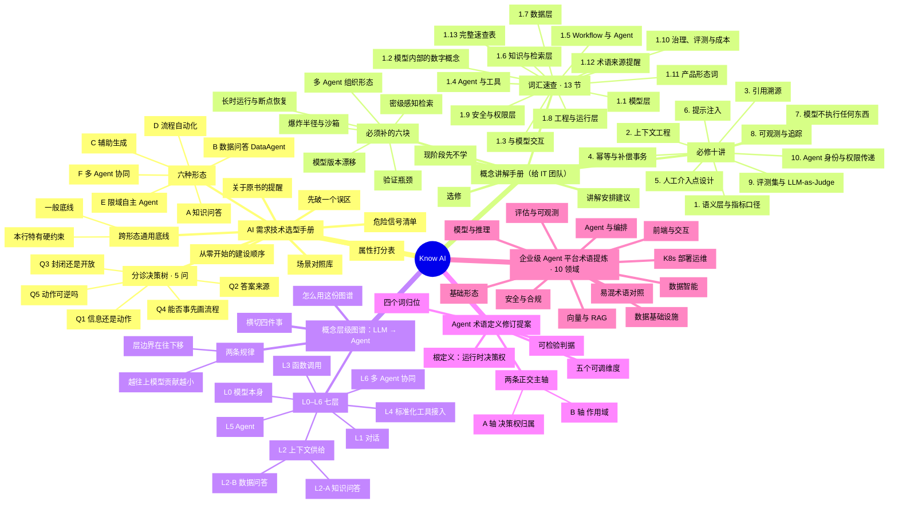

# 思维导图：Know AI全景

> 本文由 `scripts/gen-mindmap.mjs` 根据 `scripts/mindmap-src.mjs` 生成，请勿手改；改了源再跑一次脚本。站点「思维导图」页用的是同一份数据，点节点可跳到原文对应章节。

## 怎么读

1. **从中心往外**：中心是整个项目，第一圈是五份文档，第二圈是各文档的大章节，第三圈是关键小节。
2. **按角色挑分支**：新同事先看「概念层级图谱」→「概念讲解手册」；架构师接需求直接看「AI 需求技术选型手册」的分诊 5 问和六形态；评审对齐用语看「Agent 术语定义修订提案」。
3. **术语卡住时**：去「企业级 Agent 平台术语提炼」的 10 个领域或站点「术语馆」查。
4. **想看细节**：在站点打开「思维导图」页，点任意节点跳到原文库对应章节。

## 全景图

## 章节索引

- [AI 需求技术选型手册](AI%E9%9C%80%E6%B1%82%E6%8A%80%E6%9C%AF%E9%80%89%E5%9E%8B%E6%89%8B%E5%86%8C.md)：先破一个误区 · 分诊决策树 · 5 问 · 六种形态 · 跨形态通用底线 · 属性打分表 · 场景对照库 · 从零开始的建设顺序 · 危险信号清单 · 关于原书的提醒
- [概念讲解手册（给 IT 团队）](%E6%A6%82%E5%BF%B5%E8%AE%B2%E8%A7%A3%E6%89%8B%E5%86%8C_%E7%BB%99IT%E5%9B%A2%E9%98%9F.md)：词汇速查 · 13 节 · 必修十讲 · 选修 · 现阶段先不学 · 必须补的六块 · 讲解安排建议
- [概念层级图谱：LLM → Agent](%E6%A6%82%E5%BF%B5%E5%B1%82%E7%BA%A7%E5%9B%BE%E8%B0%B1_%E4%BB%8ELLM%E5%88%B0Agent.md)：L0–L6 七层 · 横切四件事 · 两条规律 · 怎么用这份图谱
- [Agent 术语定义修订提案](Agent%E6%9C%AF%E8%AF%AD%E5%AE%9A%E4%B9%89_%E4%BF%AE%E8%AE%A2%E6%8F%90%E6%A1%88.md)：根定义：运行时决策权 · 两条正交主轴 · 五个可调维度 · 可检验判据 · 四个词归位
- [企业级 Agent 平台术语提炼 · 10 领域](%E4%BC%81%E4%B8%9A%E7%BA%A7Agent%E5%B9%B3%E5%8F%B0_%E6%A6%82%E5%BF%B5%E6%9C%AF%E8%AF%AD%E6%8F%90%E7%82%BC.md)：基础形态 · 模型与推理 · 数据基础设施 · 向量与 RAG · Agent 与编排 · 评估与可观测 · 安全与合规 · K8s 部署运维 · 前端与交互 · 数据智能 · 易混术语对照
